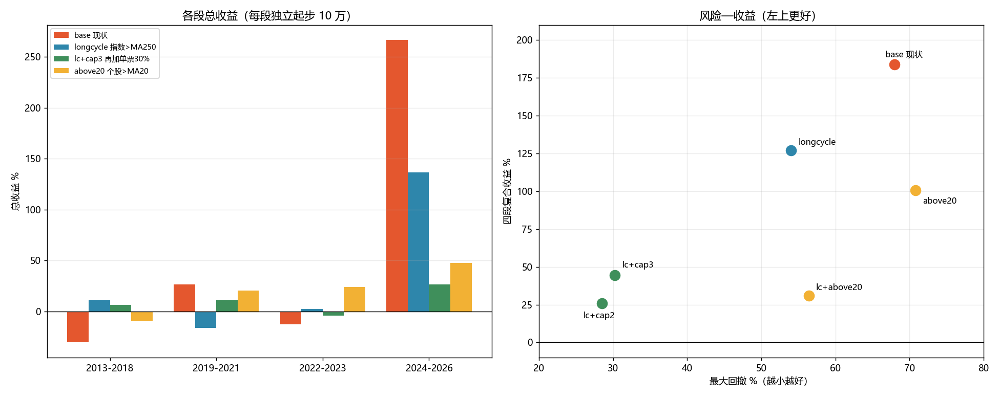

# 趋势低吸：策略优化对照测试（第三轮）

日期：2026-10-29
对象：组合 `主板+创业板`（`pf_1791522403274487100_0002`，策略 `trend_pullback_low_buy`）
数据：`bin/portfolio.db` 副本 + 数据湖 `D:\workspace\stockTool\CNEquity\data\cnequity`

> 仍然没有改生产代码。全部改动都是在测试里**改写引擎拿到的调仓计划行**实现的：
> 出场规则改「持仓行」、入场过滤丢「买入行」、单票上限夹「层数」。
> 指数闸门固定 399006、广度保持绝对阈值（第二轮已证明改相对比例是倒退）。

---

## 一、测了什么

用户的判断是「指数有波动，可以做波段赚钱」，所以分两组验证：

**A. 出场改造（做波段）**：止盈 +10/+15/+20%、移动止盈（自最高价回撤 8%/12%）、最长持有 10/20 日、放宽 MA30 止损到 ×0.90。

**B. 入场过滤**：熊市不买、5 日动量 >0、站上 MA20、只买 ≥70 分、**指数在 MA250 上方才买**（长周期闸门），以及它们的组合。

先在最差的一段（2013-2018）做筛选，再把候选放到四段（2013-2018 / 2019-2021 / 2022-2023 / 2024-2026）。

---

## 二、出场改造：全部更差

2013-2018（基准 −30.35%，回撤 66.7%）：

| 变体 | 总收益 | 最大回撤 | 成交 | 说明 |
|---|---:|---:|---:|---|
| base | **−30.35%** | 66.72% | 46 | — |
| tp10（+10% 止盈） | −30.97% | 63.04% | 102 | 交易翻倍，收益没变 |
| tp15 | −49.27% | 53.03% | 81 | 更差 |
| tp20 | −35.24% | 54.99% | 72 | 更差 |
| trail08（回撤 8%） | −69.06% | 69.06% | 77 | 最差 |
| trail12 | −33.45% | 59.68% | 47 | 更差 |
| hold10（持 10 日） | −61.49% | 67.57% | 120 | 最差之一 |
| hold20（持 20 日） | −28.72% | 63.30% | 79 | 基本持平 |
| stop90（MA30×0.90） | −27.47% | 55.87% | 25 | 略好，但仍在亏损区 |

**结论：这个策略的钱来自"让利润奔跑"，不是"高抛低吸"。**
任何"涨了就跑"的规则（止盈、移动止盈、限时）都是在砍赢家——它的胜率只有 13~30%，
利润全靠少数几笔 +40%~+85% 的大赢家；止盈把这些砍掉之后，剩下的全是小亏，必然更差。

---

## 三、入场过滤：只有"长周期闸门"有正贡献

2013-2018 筛选：

| 变体 | 总收益 | 最大回撤 | 成交 | 结论 |
|---|---:|---:|---:|---|
| base | −30.35% | 66.72% | 46 | — |
| nobear（熊市不买） | −30.35% | 66.72% | 46 | **无效果**：开仓日从来没有落在 bear 状态 |
| mom5（5 日涨幅>0） | −30.35% | 66.72% | 46 | **无效果**：候选本来就都是 5 日正收益 |
| above20（个股>MA20） | −9.34% | 62.91% | 41 | 改善 21pp |
| score70（只买≥70 分） | −45.25% | 56.86% | 50 | 更差 |
| **longcycle（指数>MA250）** | **+11.45%** | 46.74% | 28 | **由负转正** |
| **lc+above20** | **+59.76%** | **34.64%** | 26 | 本段最佳 |

### 四段汇总

| 变体 | 2013-2018 | 2019-2021 | 2022-2023 | 2024-2026 | 全段复合 | 最大回撤 | 最差单段 |
|---|---:|---:|---:|---:|---:|---:|---:|
| base | −30.35% | +26.83% | −12.35% | **+266.54%** | **+183.8%** | 68.0% | −30.4% |
| longcycle | +11.45% | −15.91% | +2.47% | +136.46% | +127.1% | 54.0% | −15.9% |
| above20 | −9.34% | +20.80% | +23.89% | +47.80% | +100.5% | 70.8% | −9.3% |
| lc+above20 | **+59.76%** | −26.75% | −5.25% | +18.05% | +30.9% | 56.4% | −26.8% |
| lc+cap2 | +5.74% | +9.52% | −4.73% | +13.91% | +25.7% | **28.5%** | **−4.7%** |
| lc+cap3 | +6.53% | +11.65% | −4.07% | +26.60% | +44.5% | 30.2% | −4.1% |



---

## 四、结论

**1. "做波段"（出场侧）被数据否定。**
9 个出场变体里 7 个更差，剩下 2 个只是略好（hold20 −28.7%、stop90 −27.5%），仍在亏损区。
这个策略的 alpha 来自持有大赢家，任何止盈/移动止盈/限时都在削它。

**2. 唯一稳定正贡献的是「长周期闸门」：闸门指数在 MA250 上方才允许开仓。**
- 2013-2018：−30.4% → +11.5%（回撤 67%→47%）
- 2022-2023：−12.4% → +2.5%
- 代价：2019-2021 +26.8% → −15.9%；2024-2026 +266.5% → +136.5%
- 四段复合 +127% vs base +184%，但回撤 54% vs 68%，且**两个熊市窗口都转正**

**3. 叠加单票上限后，波动被压到很低，但收益也回到"存款级"。**
lc+cap3：四段 +6.5% / +11.7% / −4.1% / +26.6%，回撤 30%，复合 +44.5%（12 年约 3.1%/年）。

**4. 没有任何一个配置能"收益更高且回撤更低"。**
base 的 +184% 几乎全部来自 2024-2026 的 +266.5%（单票满仓押中几只翻倍股）；
一旦分散或择时，这段超额就没了。这不是参数问题，是策略的收益结构问题。

---

## 五、建议

| 目标 | 选择 | 预期 |
|---|---|---|
| 保留长期高收益 | base 不动 | +184% / 68% 回撤，但 2013-2023 是亏的 |
| 少亏、能拿住 | **longcycle（指数>MA250 才开仓）** | +127% / 54% 回撤，熊市窗口转正 |
| 回撤优先 | lc+cap3（再加单票 30%） | +44% / 30% 回撤，约 3%/年 |
| 提高长期收益 | **改选股，不是改出场** | 本轮没有找到 |

**下一步该做的不是继续调出场/仓位，而是选股：**
- 现在是从 4600 只里按低吸条件挑 1~5 只，胜率 23%；
- 同样的闸门与仓位下，选股命中率提高 10pp，比任何出场参数的影响都大；
- 可测的方向：候选打分权重、行业分散、成交额/流动性门槛、财报/估值过滤。

---

## 六、局限

1. 四段独立回测（每段 10 万起步），段间持仓不连续；"全段复合"是连乘近似。
2. 入场/出场规则通过改写计划行实现，与"直接改 `score` 包的判定"在边界上可能有细微差异
   （例如把 replace_in 丢弃时同时撤销了配对的 replace_out）。
3. 2026 年只到 10-28。
4. `nobear` / `mom5` 在本区间是 no-op（结果与 base 完全一致），说明这两个条件在当前候选里恒满足，
   不代表它们在别的区间也没用。

---

## 七、原始数据

- `reports/exit_exp/低吸指数闸门_实验指标.csv`
- `reports/exit_exp/低吸指数闸门_闸门统计.csv`
- `reports/exit_exp/低吸指数闸门_年度收益.csv`
- `reports/exit_exp/策略优化_对比.png`

复现（longcycle 为例）：

```powershell
$env:FREESTOCK_GATE_EXP="1"
$env:FREESTOCK_GATE_DB="D:\workspace\go\stockSoft\freeStock\.gotmp\gate_exp\portfolio.db"
$env:FREESTOCK_GATE_LAKE="D:\workspace\stockTool\CNEquity\data\cnequity"
$env:FREESTOCK_GATE_PORTFOLIO="pf_1791522403274487100_0002"
$env:FREESTOCK_GATE_FROM="20130101"; $env:FREESTOCK_GATE_TO="20181231"
$env:FREESTOCK_GATE_VARIANTS="base,longcycle,above20,lc+above20,lc+cap2,lc+cap3"
$env:FREESTOCK_GATE_OUT="D:\workspace\go\stockSoft\freeStock\reports\exit_exp"
$env:GOGC="80"; $env:GOMEMLIMIT="10GiB"
go test ./internal/service -run "^TestLowBuyGateExperiment$" -v -count=1 -timeout 3h
```
