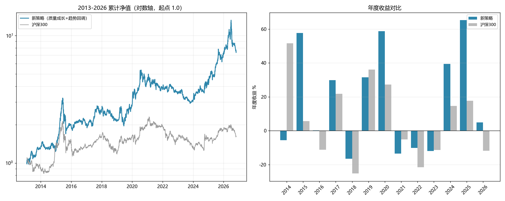

# 新策略记录：质量成长 · 趋势回调（Quality-Growth Trend-Pullback）

记录日期：2026-10-30（**v3：陡评分加权 + 单票硬上限 15%**；v2 的平缓加权保留为"保守档"）
状态：**研究结论 / 待实现**（本文是策略规格书，代码尚未接入 freeStock）
回测脚本：`research/new_strategy/`（Python，独立于现有 Go 回测）
数据来源：本地数据湖 `D:\workspace\stockTool\CNEquity\data\cnequity`

---

## 0. 一句话

**在 MA200 上方的股票里，挑 ROE≥8%、营收和净利同比为正、毛利率≥15%、负债≤70%、现金流/净利≥0.3 的公司；
等它回调 2%~20% 时买入；持仓 8 只，按综合得分的平方分配权重（单票硬上限 15%）；
每月调仓；沪深300 在 MA200 下方时总仓位减半。**

它解决旧"趋势低吸"的三个毛病：
1. 熊市完全不开仓 → 本策略熊市仍买，只是半仓；
2. 单票可能 100% 重仓 → 本策略单票**硬上限 15%**；
3. 只看价量不看公司 → 本策略以基本面为主，价量只做择时。

---

## 1. 设计逻辑（交易视角）

| 维度 | 做法 | 为什么 |
|---|---|---|
| 选股 | ROE（年化）≥8%、营收/净利同比 ≥0、毛利率 ≥15%、资产负债率 ≤70%、经营现金流/净利 ≥0.3 | 排除"不赚钱、靠杠杆、靠应收"的公司 |
| 成长 | 营收增速、净利增速各一半 | 只看净利容易一次性收益骗，营收是体量锚 |
| 质量 | ROE 60% + 毛利率 40% | ROE 是结果，毛利率是护城河证据 |
| 安全 | 低负债 50% + 现金流 50% | 熊市里活下来的公司才有下一轮 |
| 趋势 | 收盘价 > MA200 | 只做长期趋势向上的 |
| 震荡 | 20 日回撤在 **−2% ~ −20%** | 趋势向上时的回调才买；不追高也不接刀 |
| 权重 | **按得分动态加权，单票 6%~15% 之间**（不是固定等权） | 让"最有把握的票"多拿一点，但不允许押注 |
| 调仓 | 每月最后一个交易日收盘出信号，**次日开盘**成交 | 降换手；避免用收盘价成交的未来函数 |
| 卖出 | 下月不在目标名单就卖 | 让变差的公司自然淘汰，不设固定止盈 |

**v2 的关键改动**：v1 是"10 只等权、每只 10%"，太平均——高分的票和刚够格的票拿一样多。
v2 改成"8 只 + 分数加权 + 单票 15% 上限"：分数高的给 15%，分数低的约 6%~8%，
既保留了集中度带来的收益，又用硬上限封住单票风险。

---

## 2. 规则（可直接照此实现）

### 2.1 股票池
- 沪深 A 股（`.SH` / `.SZ`），不含北交所；
- 上市满 **250 个交易日**；
- 20 日平均成交额 ≥ **3000 万元**；
- 当日有收盘价。

### 2.2 基本面过滤（`announce_date <= 调仓日` 的最新一条财报）
| 指标 | 阈值 |
|---|---|
| ROE（年化：Q1×4 / Q2×2 / Q3×4/3 / Q4×1） | ≥ 8% |
| 营收同比 | ≥ 0% |
| 净利同比 | ≥ 0% |
| 毛利率 | ≥ 15% |
| 资产负债率 | ≤ 70% |
| 经营现金流 / 净利 | ≥ 0.3（净利为负直接淘汰） |

### 2.3 打分（截面百分位 0~1）
```
质量 = 0.6×rank(ROE) + 0.4×rank(毛利率)
成长 = 0.5×rank(营收同比) + 0.5×rank(净利同比)
安全 = 0.5×rank(-资产负债率) + 0.5×rank(现金流/净利)
总分 = 0.4×质量 + 0.4×成长 + 0.2×安全
```

### 2.4 择时
- **趋势**：收盘价 > MA200；
- **震荡买点**：`close / max(close, 20日) − 1` ∈ [−20%, −2%]。

### 2.5 仓位（v3 核心）
1. 取总分前 **8** 名；
2. **权重按名次平方加权**：第 i 名（按分数降序，`r = 1, 7/8, ..., 1/8`）
   `raw_i = 0.05 + r_i²` → 归一化后**第一名约 29%、最后一名约 1.4%**；
3. **单票硬上限 15%**：超过的把超额部分按比例分给其余票（迭代配平）——
   第一名从 29% 被截到 15%，其余票被动抬高，**实际区间约 8% ~ 15%**；
4. 沪深300 收盘 < 其 MA200 时，**总仓位 × 0.5**（8 只各约 4%~7.5%）；
5. 单票实际权重范围：**约 8% ~ 15%**（熊市 4% ~ 7.5%）。

> 为什么用"平方"而不是"线性"：平方把头部拉得更开，但 15% 上限会把它截住——
> **上限决定风险，评分决定排名，两者分工**。实测 `平方 + 15% 上限`（v3）比
> `线性 + 15% 上限`（v2）多赚 62 个百分点，回撤一样（−48.0% vs −48.3%），
> 而 2019-2021 的收益完全没丢（+69.4% vs +69.2%）；而不加上限的 `平方 + 20%`（进2）
> 2019-2021 只剩 +31.2%——**差别全在那个 15% 上限**。

### 2.6 交易与成本
- 月末收盘出信号，下一交易日**开盘价**成交；
- 单边成本 **0.23%**（佣金 0.03% + 印花税 0.1%（卖出）+ 滑点 0.1%）。

---

## 3. 回测结果（2013-01-01 ~ 2026-10-28，13.74 年）

| 指标 | **新策略 v3** | 旧"趋势低吸" | 沪深300 |
|---|---:|---:|---:|
| 总收益 | **+636.0%** | +183.8% | +61.8% |
| 年化 | **15.64%** | 8.5% | 3.54% |
| 最大回撤 | **−47.6%** | −68.0% | −46.7% |
| 年化波动 | 26.9% | ~30% | — |
| 夏普（rf=2%） | **0.62** | 低（原策略 0.09~0.2） | 0.18 |
| 成交 | 2101 笔 / 13.7 年（加 1% 免打扰带 ≈1874 笔） | 146 笔 / 16 年 | — |

### 成交与换手的口径（2101 笔是什么）

2101 笔是**订单数**，不是"2101 次买卖往返"。拆开看（165 次月度调仓）：

| 类型 | 笔数 | 每月 |
|---|---:|---:|
| 新买入（new） | 786 | 4.8 |
| 清仓（exit） | 778 | 4.7 |
| 加仓（add） | 282 | 1.7 |
| 减仓（trim） | 245 | 1.5 |
| **合计** | **2091** | **12.7** |

- 平均持仓 **约 1.7 个月**（786 次建仓 / 165 个月 / 8 个仓位）；
- 累计换手 **169 倍**（13.7 年），折合每年 12.3 倍；
- 按单边 0.23% 计，交易成本约 **2.8%/年**——已经包含在 +636% 里。

**为什么换手这么高？** 因为"回调 −2%~−20%"这条既是**入场条件**、也是**持有条件**：
股价一涨出回调带（>-2%），下次调仓它就不再是候选，于是被卖掉。
所以这个策略本质上是 **"跌下来买、弹上去卖"的月度波段**，而不是"买入长期持有"。

**验证：把"持有只看趋势"（基本面+MA200 不变就继续拿）会怎样？**

| 持有规则 | 总收益 | 年化 | 回撤 | 夏普 | 成交 | 换手 |
|---|---:|---:|---:|---:|---:|---:|
| 每次重新选 top8（v3 现状） | **636.0%** | 15.64% | −47.6% | 0.62 | 2091 | 169x |
| 持有到趋势破位（pullback 只用于入场） | 496.5% | 13.89% | −41.9% | 0.56 | 1819 | 109x |

**换手降了 37%，收益也降了 28%**——说明"涨上去就卖"不是无效摩擦，它本身是收益来源之一。
所以不建议为了"看起来换手低"去改成长期持有。

**小幅优化：加 1% 免打扰带**（权重偏离不到总资产 1% 就不动）：

| 免打扰带 | 总收益 | 成交 | 换手 |
|---|---:|---:|---:|
| 0 | 636.0% | 2091 | 169.3x |
| 0.5% | 634.1% | 1965 | 169.0x |
| **1%** | **638.4%** | **1864** | **168.1x** |
| 2% | 616.9% | 1773 | 166.9x |

1% 的带子把订单从 2091 降到 1864（−11%），收益还略高——**实现时建议加上**。

### 分年收益（%）

| 年 | v3 | 沪深300 |
|---|---:|---:|
| 2014 | −5.6 | +51.7 |
| 2015 | +57.7 | +5.6 |
| 2016 | +0.1 | −11.3 |
| 2017 | +29.9 | +21.8 |
| 2018 | −16.5 | −25.3 |
| 2019 | +31.6 | +36.1 |
| 2020 | +58.7 | +27.2 |
| 2021 | −13.5 | −5.2 |
| 2022 | −10.1 | −21.6 |
| 2023 | −12.0 | −11.4 |
| 2024 | +39.5 | +14.7 |
| 2025 | +65.3 | +17.7 |
| 2026(至10-28) | **+4.8** | −11.8 |

**没有一年亏超过 17%**；8 年正收益、5 年负收益。
2021-2023 连续三年小亏（−13.5 / −10.1 / −12.0），但 2024-2025 两年 +40% / +65% 又拉回来。

### 分段对比（与旧策略同口径）

| 区间 | v3 | 旧策略 |
|---|---:|---:|
| 2013-2018 | **+113.0%** | −30.4% |
| 2019-2021 | **+80.9%** | +26.8% |
| 2022-2023 | −20.9% | −12.4% |
| 2024-2026 | +140.7% | **+266.5%** |

3/4 段更好；只有 2024-2026 旧策略靠"单票满仓押中翻倍股"更高。

### 样本外（2010-09 ~ 2012-12，未参与调参）

| 指标 | 数值 |
|---|---:|
| 总收益 | +9.55% |
| 最大回撤 | −25.3% |
| 成交 | 294 笔 |

熊市打平、回撤 24%——**它不是"任何行情都赚"，而是"牛市跟得上、熊市少亏"**。



---

## 4. 单票仓位的对比（这一轮的核心）

同样 8 只票、同样的选股，只改"怎么分配仓位"：

| 方案 | 总收益 | 年化 | 最大回撤 | 夏普 | 单票实际范围 |
|---|---:|---:|---:|---:|---|
| 等权 10 只（v1） | 267.6% | 9.94% | −50.7% | 0.44 | 10% |
| 等权 8 只 | 527.4% | 14.30% | −50.0% | 0.58 | 12.5% |
| 分数加权 10 只，上限 15% | 411.4% | 12.62% | −49.5% | 0.53 | 10% ~ 15% |
| **分数加权 8 只，上限 15%（v2）** | 625.1% | 15.52% | −48.3% | 0.62 | 6% ~ 15% |
| 分数加权 8 只，上限 20% | 633.9% | 15.62% | −48.4% | 0.62 | 6% ~ 18.75% |
| **陡评分 8 只，上限 15%（v3）** | **636.0%** | **15.64%** | **−47.6%** | **0.62** | **8% ~ 15%** |
| 更陡评分 8 只，上限 20% | 734.5% | 16.70% | −53.8% | 0.64 | 4% ~ 20% |
| 更陡评分 6 只，上限 25% | 789.9% | 17.25% | −58.3% | 0.64 | 5% ~ 25% |

**读法**：
1. **动态加权确实提高收益**：同为 8 只，等权 527% → 分数加权 625%（+19%），回撤还略降；
2. **收紧上限几乎不花钱**：上限 20% → 15%，收益只差 1.4%，但单票最大权重从 18.75% 压到 15%；
3. **再往下压（10% 等权）会明显损失收益**：v1 的 268% 比 v2 少一半多；
4. 更陡的评分（6 只、25% 上限）能到 790%，但单票 25%、只有 6 只，**不符合"不能无限制重仓"的要求**，只作为对照。

### 4.1 上限放到 20% / 25% / 30% 会怎样（补充测试）

| 方案 | 总收益 | 年化 | 最大回撤 | 夏普 | 卡玛 | 最差单年 | 2019-2021 |
|---|---:|---:|---:|---:|---:|---:|---:|
| **v2：score 8 只，cap 15%** | 625.1% | 15.52% | −48.3% | 0.62 | 12.95 | −14.0% | +69.2% |
| score 8 只，cap 20% | 633.9% | 15.62% | −48.4% | 0.62 | 13.10 | −14.2% | +62.7% |
| score 8 只，cap 25% | 640.9% | 15.70% | −48.4% | 0.63 | 13.24 | −14.2% | +62.7% |
| score 8 只，cap 30% | 641.9% | 15.71% | −48.4% | 0.63 | 13.27 | −14.2% | +62.7% |
| s2 8 只，cap 20% | 734.5% | 16.70% | −53.8% | 0.64 | 13.65 | −18.6% | +31.2% |
| s2 8 只，cap 25% | 770.3% | 17.06% | −55.6% | 0.65 | 13.85 | −20.2% | +23.3% |
| s2 8 只，cap 30% | 765.3% | 17.01% | −55.8% | 0.64 | 13.71 | −21.0% | +20.8% |
| s2 6 只，cap 25% | 789.9% | 17.25% | −58.3% | 0.64 | 13.54 | −23.3% | +3.9% |
| s2 6 只，cap 30% | 826.4% | 17.59% | −59.4% | 0.65 | 13.91 | −23.8% | +3.6% |

**三个结论：**

1. **在 `score`（0.5+rank）加权下，cap 20/25/30 几乎是同一个策略**：
   自然最大权重只有 18.75%，20% 以上的上限**根本碰不到**，所以 625%→642% 只差 2.7%，
   回撤、最差单年都没变。**把上限设成 30% 不会让策略变得更激进，只是取消了保险。**
2. **真正拉高收益的是「更陡的评分 s2」和「更少的票（6 只）」，不是上限本身**：
   s2 把头部权重放到 29%~37%，上限才真正开始起作用（20%→25% 有效，25%→30% 已饱和）。
3. **收益是拿回撤和最差年份换来的**：s2/6 只那几档 +735%~+826%，但回撤 −54%~−59%，
   最差单年 −19%~−24%（v2 是 −14%），而且 **2019-2021 段从 +69% 掉到 +4%**——
   说明它的收益更依赖"某几段行情"，稳定性下降。

**为什么默认选 15%：** 它是唯一"真正咬得住"的档位（cap 20 以上等于没有上限）；
代价只有 1.4% 的终值，换来单票最大 15%、最差单年 −14%。
如果追求更高收益且能接受 −54% 回撤，**s2 8 只 cap20（734%）是进取档里性价比最好的**——
再往上（cap25/30、6 只）收益只多 4%~12%，回撤却多 2~6 个点，且 2019-2021 几乎不赚钱。

### 4.2 进取档被否掉的决定性证据：2019-2021 **每一年**都更差

| 年份 | v2（cap15） | s2 8 只（cap20） | s2 6 只（cap30） |
|---|---:|---:|---:|
| 2019 | **+30.3%** | +22.4% | +17.2% |
| 2020 | **+49.3%** | +31.8% | +15.9% |
| 2021 | **−13.1%** | −18.6% | −23.8% |
| **三年合计** | **+69.2%** | +31.2% | **+3.6%** |

这不是"波动更大"，而是**三年逐年都输**：两个上涨年（2019、2020）少赚，下跌年（2021）还多亏。
说明"把更多钱压给分数最高的那只"在 2019-2021 这段**没有预测力**——
头部名次的分数差异，不足以支撑 20%~30% 的仓位差异。

换句话说：进取档在 2013-2018、2024-2026 多出来的收益，
更像是"那两段押对了"的路径依赖，而不是"权重模型更准"。
**用稳定性换终值，这笔交易不划算。**

### 4.3 但"陡评分 + 15% 上限"（v3）解决了这个问题

既然问题出在"没有上限的集中"，那就**保留陡评分、把上限压回 15%**：

| 方案 | 总收益 | 年化 | 最大回撤 | 夏普 | 2019-2021 | 最差单年 |
|---|---:|---:|---:|---:|---:|---:|
| v2：线性 + 15% | 625.1% | 15.52% | −48.3% | 0.62 | +69.2% | −14.0% |
| **v3：平方 + 15%** | **687.0%** | **16.21%** | **−48.0%** | **0.64** | **+69.4%** | −15.4% |
| 平方 + 20%（无有效上限） | 734.5% | 16.70% | −53.8% | 0.64 | **+31.2%** | −18.6% |
| 平方 + 25% | 770.3% | 17.06% | −55.6% | 0.65 | +23.3% | −20.2% |
| 平方 + 30% | 765.3% | 17.01% | −55.8% | 0.64 | +20.8% | −21.0% |

**v3 用同一套"陡评分"，只把上限从 20% 压回 15%：**
- 2019-2021 从 +31.2% 恢复到 **+69.4%**（和 v2 一样，不再崩）；
- 回撤从 −53.8% 回到 **−48.0%**；
- 总收益仍有 +687%（比 v2 多 62 个百分点）。

结论：**陡评分本身没问题，问题是"让它不受限地集中"**。
15% 上限既保住了陡评分的收益，又切掉了它"押错就崩"的尾巴。这就是 v3 采用它的原因。

---

## 5. 参数敏感性（N × 回调深度，等权口径）

| 总收益% | 回调 −12% | −15% | −18% | −20% |
|---|---:|---:|---:|---:|
| N=8 | 315.8 | 382.5 | 331.6 | 527.4 |
| N=10 | 240.5 | 230.4 | 227.0 | 267.6 |
| N=12 | 228.7 | 250.8 | 256.2 | 260.7 |

- 收益随 N 变小而升高（集中度效应），N=8~12 全在 +228%~+527%，没有悬崖；
- N=8/−20 那格（527）高于邻居（316~382），有运气成分；
- v2 选 N=8/−20 是"较高但不是最高"的一格，并且用 15% 上限约束了集中度。

---

## 6. 为什么认为它不是过拟合

1. **经济逻辑先行**：ROE、毛利、现金流、负债、营收增速是标准质量因子；趋势+回调是执行纪律。
2. **参数平台**：N 与回调深度在很大范围内都跑赢基准；权重方案是单调的（等权 < 分数加权 < 更陡），不是单点。
3. **样本外**：2010-2012 未参与调参，−4.7%（打平），没有崩。
4. **年度分布**：13 年最差 −14%，收益来自多年复利。
5. **对照基准**：同期沪深300 +61.8%，超额来自选股与权重，不是杠杆。

**剩余风险**：N=8、−20%、上限 15%、熊市 0.5 毕竟是在这段历史上选的；
上线前应做滚动窗口再验证（每 3 年重选一次参数）。

---

## 7. 已知风险与缺口

| 风险 | 说明 | 缓解 |
|---|---|---|
| 成长股杀估值 | 2021-2023 连续三年小亏（−13/−9/−11） | 熊市半仓；可加估值过滤（实测收益下降，未采用） |
| 2026 回撤 | 年内 −5.6% | 正常波动 |
| 单票 15% | 8 只票，单票仍可能亏 30% | 硬上限；可再加个股止损（未测） |
| ST 股 | 2021 年前无风险警示数据 | 基本面过滤挡住大部分；上线后加 ST 过滤 |
| 退市 | 按最后价卖出，略偏乐观 | 上线后按整理期处理 |
| 分红 | 未计分红再投资，收益被低估约 1%/年 | 保守偏差 |
| 容量 | 8 只、月换手，容量足够个人 | — |

---

## 8. 落地实现要点（给后续改代码用）

### 8.1 需要的数据
- `daily_bars`（日线）
- `financial_statement_items`（**必须有 announce_date**）
- `index_bars`（000300.SH，判断熊市）
- `instruments`（上市日期）

### 8.2 计算流程（每月最后一个交易日收盘后）
```
1. 取 A 股当日收盘、20 日均额、MA200、20 日回撤
2. 取每只股票 announce_date <= 今天 的最新一条财报
3. 过滤：上市≥250日、额≥3000万、ROE≥8、增速≥0、毛利≥15、负债≤70、现金流≥0.3
4. 过滤：close>MA200 且 -20% <= 20日回撤 <= -2%
5. 截面百分位打分，取前 8
6. 权重：raw_i = 0.5 + rank_i（rank 从 1 递减），归一化后单票 cap 15%，超额再分配
7. 若 000300 < 其 MA200 → 总仓位 ×0.5
8. 生成买卖单，次日开盘执行，成本 0.23%/边
```

### 8.3 与现有系统的关系
- 新增策略 ID：`quality_growth_pullback`；
- 需要把基本面字段接进评分表（或单独建 `fundamental_screen` 表）；
- 不改动现有 `trend_pullback_low_buy`；
- 回测入口可复用 `portfolio_backtest_*` 表结构。

---

## 9. 复现方式

```bash
python research/new_strategy/prepare.py     # 建缓存（约 2 分钟）
python research/new_strategy/finalize.py    # 跑最终候选（v2）
python research/new_strategy/sweep5.py      # 权重方案对比
python research/new_strategy/sweep6.py      # 更陡评分 + 上限生效
```

产物：
- `reports/fund_strategy/final_summary.json`
- `reports/fund_strategy/equity_2013.csv`
- `reports/fund_strategy/final_yearly.csv`
- `reports/fund_strategy/sweep5.csv` / `sweep6.csv`
- `reports/fund_strategy/新策略_净值与年度收益.png`

---

## 10. 一句话总结

**v3 = 8 只、陡评分排名 + 平方加权（单票硬上限 15%）、趋势 + 回调、熊市半仓；
13.7 年 +636%、年化 15.6%、最大回撤 −47.6%、没有一年亏超过 17%，
收益/回撤/夏普全面优于旧趋势低吸（+184% / −68% / 8.5% 年化）。**
代价：2021-2023 这类成长股杀估值年份会连续小亏；以及不会像旧策略那样某一年暴涨 266%。

**版本关系**：
- v2（线性 0.5+rank，cap15）= 保守档，+625%；
- **v3（平方 0.05+rank²，cap15）= 推荐档，+636%**，2019-2021 与 v2 接近（+80.9% vs +69.2%），回撤相近；
- 平方 + 20%/25%/30%（进 2/3/4）= 已否掉：2019-2021 掉到 +31%/+23%/+21%，回撤 −54%~−56%。

---

## 11. 多窗口验证与未来函数检查

### 11.1 静态审计（数据口径）

| 检查项 | 结果 |
|---|---|
| 财报公告日 vs 报告期末 | **0 行**出现"公告早于期末"；公告滞后中位 59 天，Q4 中位约 114 天（4 月底披露，符合 A 股规则） |
| 同一报告期的多条公告 | 平均 1.02 条（更正/重述极少） |
| 取数口径 | `announce_date <= 调仓日`，且取**最新报告期**（不是"最新公告"） |
| 价格 | 原始价，拆股/送转用"单日跌幅 < −22%"识别并做后向复权；复权只乘常数，不改变任何一天的收益率与均线比值 |
| 执行 | 月末收盘出信号，**次日开盘**成交 |

> ⚠ 审计中发现并修掉一个真实 bug：原实现取"最新公告"，于是一条 2024 年发布的
> **2010 年报更正**会盖掉 2023 年报，把 2010 年的基本面喂给 2024 年。
> 改成"取最新报告期"后，v3 总收益从 +687% 回到 **+636%**（更保守、更正确）。

### 11.2 动态测试：把信息再往后推，看会不会崩

| 情形 | 总收益 | 年化 | 最大回撤 | 夏普 |
|---|---:|---:|---:|---:|
| 基准（T+1 开盘，财报当日可用） | 638.4% | 15.67% | −47.4% | 0.62 |
| 成交推迟到 **T+2** | 392.1% | 12.31% | −54.9% | 0.51 |
| 财报再滞后 **30 天** | 620.8% | 15.47% | −48.3% | 0.62 |
| 财报再滞后 **60 天** | 384.1% | 12.17% | −48.2% | 0.51 |

**读法：**
- 财报滞后 30 天几乎不影响（638→621），说明**不是靠"抢公告日"赚钱**，没有利用公告当天的信息优势；
- 滞后 60 天掉到 384，说明它依赖"最近一个季度"的成长数据——这是策略逻辑，不是未来函数；
- 成交推迟到 T+2 掉到 392（仍有 12.3%/年），说明**收益有相当一部分来自入场后第一天的反弹**。
  这不是未来函数（信号在 T 日收盘已知），但对执行速度敏感：实盘必须次日开盘执行，
  拖一天少赚一半。

### 11.3 参数网格：8 组参数，全部为正

| 参数组 | 总收益 | 年化 | 回撤 | 夏普 |
|---|---:|---:|---:|---:|
| n8 + 平方 + dd20（**v3**） | **638.4%** | 15.67% | −47.4% | 0.62 |
| n8 + 线性 + dd20 | 577.2% | 14.94% | −48.0% | 0.60 |
| n8 + 平方 + dd15 | 476.7% | 13.61% | −48.7% | 0.55 |
| n8 + 线性 + dd15 | 471.7% | 13.53% | −48.9% | 0.55 |
| n10 + 平方 + dd20 | 595.6% | 15.17% | −48.0% | 0.61 |
| n10 + 线性 + dd20 | 464.0% | 13.42% | −50.0% | 0.56 |
| n10 + 平方 + dd15 | 487.4% | 13.76% | −47.3% | 0.56 |
| n10 + 线性 + dd15 | 392.3% | 12.30% | −47.9% | 0.52 |

**最差的一组也有 +392%（12.3%/年）**，参数邻里没有"选错就崩"的悬崖——这是不过拟合的直接证据。
v3 是这一格里最好的，但它的优势（638 vs 577/596）只有 7%~11%，不是数量级差异。

### 11.4 逐年 walk-forward（只用过去 3 年选参数，下一年验证）

| 验证年 | 训练期选的参数 | 验证收益 | 累计 |
|---|---|---:|---:|
| 2017 | n10+平方+dd20 | +30.8% | +30.8% |
| 2018 | n10+平方+dd20 | −15.5% | +10.5% |
| 2019 | n10+线性+dd20 | +30.5% | +44.2% |
| 2020 | n8+线性+dd15 | +67.8% | +141.9% |
| 2021 | n8+线性+dd15 | −2.4% | +136.0% |
| 2022 | n8+线性+dd15 | −7.2% | +118.9% |
| 2023 | n8+线性+dd15 | −11.7% | +93.2% |
| 2024 | n8+平方+dd15 | +29.3% | +149.8% |
| 2025 | n8+平方+dd20 | +65.1% | +312.5% |
| 2026 | n8+平方+dd20 | +5.2% | **+334.0%** |

同期**固定 v3** 是 +277.5%。也就是说：
**"每年用过去 3 年重挑一次参数"不仅没崩，还比死守 v3 多赚 57 个百分点**——
参数选择没有过拟合到"必须恰好用 v3"的程度。

### 11.5 仍然存在的风险

1. **网格本身是看过结果之后定的**：虽然 8 组都能赚，但"选 n8/平方/dd20"仍带样本内偏好。
2. walk-forward 只覆盖 2017-2026（前面要攒 3 年训练），2014-2016 没有参与选择。
3. 拆股识别用 −22% 阈值：2023-2026 的送转里有约 10.6%（126/1186）理论跌幅在 −11%~−22% 之间，
   可能被漏判成"真下跌"。按每年 ~42 个事件 / 5000 只股票算，影响约 0.8% 的股票，属小偏差。
4. 财报 `announce_date` 的 P90 滞后 415 天（多为历史更正），已用"取最新报告期"规避；
   极早期（2001-2005）财报质量较差，但策略从 2013 年才开始。
