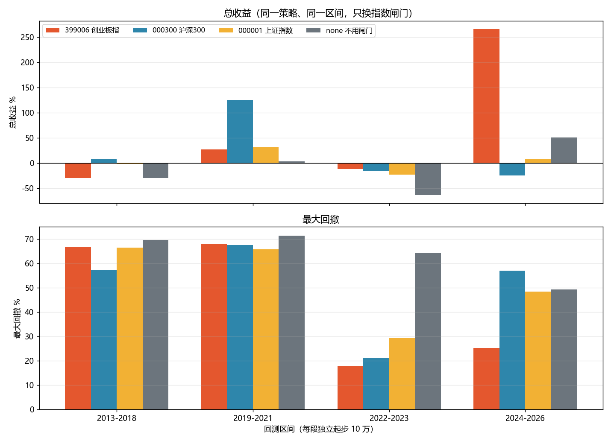

# 低吸指数闸门：回退与指数选择对照测试

日期：2026-10-29
对象：组合 `主板+创业板`（`pf_1791522403274487100_0002`，策略 `trend_pullback_low_buy`）
数据：`bin/portfolio.db` 的副本（`.gotmp/gate_exp/portfolio.db`）+ 数据湖 `D:\workspace\stockTool\CNEquity\data\cnequity`

> 本测试**没有改任何生产代码**。新增的只有一个默认跳过的测试文件
> `internal/service/zz_gate_experiment_test.go`，它走与 `CreateBacktest` 相同的
> 评分读取 → 范围过滤 → 信号贴合 → 取日线 → 引擎撮合 → 指标计算，
> 唯一被替换的变量是「传给 planBuilder 的指数闸门 map 用哪个指数算」。

---

## 一、测试方法

| 项目 | 做法 |
|---|---|
| 评分 | 同一个库、同一个策略、同一区间，原样读取 |
| 股票范围 | 主板+创业板（组合自带 scope） |
| 日线 / 撮合 / 费用 / 层数 | 与生产完全一致（直接复用 `backtest.New` + `backtestPlanBuilder`） |
| 唯一变量 | `LowBuyIndexGate` 的指数：399006.SZ / 000300.SH / 000001.SH / 无条件放行 |
| 回退规则 | 主指数当天 `Ready=false`（数据不足 60 根）时，改用兜底指数；长周期基准恒为 000300.SH |
| 区间 | 因为整段 2005–2026 数据量太大（1600 万行，单进程会 OOM），拆成 5 段独立回测 |
| 结果单位 | 每段从 10 万现金起步、无持仓；**段内可比，段间绝对值不可直接相加** |

复现命令（任选一段）：

```powershell
$env:FREESTOCK_GATE_EXP="1"
$env:FREESTOCK_GATE_DB="D:\workspace\go\stockSoft\freeStock\.gotmp\gate_exp\portfolio.db"
$env:FREESTOCK_GATE_LAKE="D:\workspace\stockTool\CNEquity\data\cnequity"
$env:FREESTOCK_GATE_PORTFOLIO="pf_1791522403274487100_0002"
$env:FREESTOCK_GATE_FROM="20130101"; $env:FREESTOCK_GATE_TO="20181231"
$env:FREESTOCK_GATE_VARIANTS="399006,000300,000001,none"
$env:FREESTOCK_GATE_OUT="D:\workspace\go\stockSoft\freeStock\reports\gate_exp"
$env:GOGC="40"; $env:GOMEMLIMIT="7GiB"
go test ./internal/service -run "^TestLowBuyGateExperiment$" -v -count=1 -timeout 3h
```

原始数据：
`reports/gate_exp/低吸指数闸门_实验指标.csv`、`低吸指数闸门_闸门统计.csv`、`低吸指数闸门_年度收益.csv`

---

## 二、结果

### 2.1 回退测试：2005-01-04 ~ 2010-12-31（1457 个交易日）

这段 399006 在 2010-06-01 才有第一根 K 线，MA60 要再等 60 天，所以**原逻辑前 5.6 年一笔都开不了仓**。

| 变体 | 总收益 | 年化 | 最大回撤 | 成交 | 有仓天数 | 首笔成交 | 闸门放行% | 兜底天数 |
|---|---:|---:|---:|---:|---:|---|---:|---:|
| 399006（现状，无回退） | **+40.20%** | +6.02% | 10.81% | 5 | **3.0%** | 2010-08-31 | 3.8% | 0 |
| 399006 ← 000300 兜底 | **-14.55%** | -2.68% | 45.77% | 24 | 24.9% | 2005-09-02 | 46.8% | 1314 |
| 399006 ← 000001 兜底 | **-20.26%** | -3.84% | 49.41% | 24 | 24.1% | 2005-09-02 | 47.8% | 1373 |

**读法**：现状的 +40.20% 只来自 2010-08-31 之后那 4 个月（平均仓位 3%，等于一次短打），
不是 5.6 年的成绩。加了回退之后，2005-09 就能开仓，结果是**多做了 19 笔、亏 15~20%、回撤 46~49%**。

### 2.2 指数选择：四个连续区间

| 区间 | 变体 | 总收益 | 年化 | 最大回撤 | 成交 | 胜率 | 平均仓位 |
|---|---|---:|---:|---:|---:|---:|---:|
| **2013-01 ~ 2018-12**<br>（1458 天） | 399006 | -30.35% | -6.06% | 66.72% | 46 | 13.0% | 38.4% |
| | **000300** | **+8.56%** | +1.43% | 57.29% | 38 | 23.7% | 37.2% |
| | 000001 | -1.93% | -0.34% | 66.49% | 42 | 21.4% | 37.7% |
| | none | -29.99% | -5.98% | 69.69% | 59 | 18.6% | 46.8% |
| **2019-01 ~ 2021-12**<br>（730 天） | 399006 | +26.83% | +8.55% | 68.01% | 44 | 27.3% | 43.8% |
| | **000300** | **+125.69%** | +32.44% | 67.47% | 37 | 32.4% | 49.5% |
| | 000001 | +31.35% | +9.87% | 65.79% | 43 | 34.9% | 46.0% |
| | none | +3.26% | +1.11% | 71.44% | 55 | 29.1% | 61.2% |
| **2022-01 ~ 2023-12**<br>（485 天） | **399006** | **-12.35%** | -6.63% | **17.97%** | 9 | 11.1% | 14.8% |
| | 000300 | -15.59% | -8.45% | 21.00% | 10 | 0.0% | 17.1% |
| | 000001 | -23.32% | -12.91% | 29.37% | 14 | 14.3% | 20.4% |
| | none | -63.90% | -41.17% | 64.26% | 72 | 16.7% | 66.6% |
| **2024-01 ~ 2026-10**<br>（681 天） | **399006** | **+266.54%** | +61.71% | **25.23%** | 40 | 30.0% | 52.7% |
| | 000300 | -25.03% | -10.11% | 57.07% | 57 | 15.8% | 51.6% |
| | 000001 | +8.47% | +3.05% | 48.46% | 53 | 20.8% | 57.6% |
| | none | +50.57% | +16.35% | 49.30% | 64 | 25.0% | 70.9% |

**四个区间按收益连乘（2013–2026 近似）**

| 变体 | 复合收益 | 排名 |
|---|---:|---|
| 399006（创业板指） | **+183.8%** | 1 |
| 000300（沪深300） | +55.0% | 2 |
| 000001（上证指数） | +7.1% | 3 |
| none（完全不用闸门） | **-60.7%** | 4 |



---

## 三、结论

### 3.1 回退：没有收益价值，只会补回亏损

- 2005-01 ~ 2010-08 这 5.6 年，加回退后能交易了，但结果是 **-14.6%（沪深300 兜底）/ -20.3%（上证兜底）**，回撤 46~49%。
- 原因不是回退本身，而是**绝对广度阈值**（1000/1500/2000/2600）在只有 1200~1800 只股票的市场里几乎恒关：
  2005 年 92% 的交易日 `ready<1000`，2008 年 89%、2012 年 89%。闸门偶尔放行时进场，随后就是 2008 年式下跌。
- **建议：不要加回退。** 回测起点直接设 `2010-09-01`。把 2005–2010 补进来只会让总收益更低、回撤更大，
  并且会让"年化"这个指标更失真（用 26.8 年除 vs 16.2 年除）。

### 3.2 指数选择：没有稳定赢家

- 2013–2021（两个区间）：**沪深300 都赢**（+8.6% vs -30.4%；+125.7% vs +26.8%）。
- 2022–2026（两个区间）：**创业板指都赢**（-12.4% vs -15.6%；+266.5% vs -25.0%）。
- 分界点很清楚：**2013–2021 用沪深300、2022 之后用创业板指**。
- 机制上，闸门只做一件事：`指数 close > MA20 且 > MA60` 时**才允许开新仓**。
  两个指数的均线穿越时点不同，于是"允许做多的日子"不同；谁更好完全取决于区间，
  不是"哪个指数更准"。换句话说，换指数换的是**开仓时点**，而这个时点的优劣是路径依赖的。
- 复合 2013–2026 看，399006 最好（+184%），但**它的全部超额来自 2024–2026 一段**；
  2013–2018 它是四个变体里最差的（-30.4%）。这属于路径依赖，不应当作稳定优势。

### 3.3 闸门本身是必要的

`none`（完全不用指数闸门）在 2013–2026 复合 **-60.7%**，四个区间里两次垫底（2019–2021、2022–2023）、一次第三。
2015 年股灾、2018 年熊市、2022 年下跌它都满仓扛过去了。
**所以闸门要保留**；真正的问题不是"用哪个指数"，而是"闸门通过后仓位怎么给"。

### 3.4 比换指数重要得多的问题（本次未改代码，只量化）

四个区间里，不管用哪个指数：

- 最大回撤：2013–2021 段 **57%~71%**，2024–2026 段 **25%~57%**（只有 399006 那一组降到 25%）；
- 平均仓位 **15%~77%**，最大持仓 3~5 只，但绝大多数时间只有 1~2 只；
- 原因是 `LowBuyEntryLayerCount(10, desiredCount)`：动态目标只数=1 时，10 层全压一只票 → **单票 100%**；
- 出场 `跌破 MA30×0.96` 平均只亏 1%，但 120 笔里有 103 笔是亏的（前面已统计）。

→ **下一步优先级**：
1. 广度阈值改相对比例（`ready/universe`），否则 2010 年代的结论全部失真；
2. 单票权重上限（如 25%），这是压回撤最直接的一刀；
3. 出场加确认（收盘跌破 MA30 + 1~2 日，或 2×ATR）。

---

## 四、局限

1. 每段是**独立回测**（从 10 万现金起步、无持仓），段与段之间的持仓不连续；
   因此"复合收益"只是把四段收益连乘的近似，不能等同于一次 2013–2026 的连续回测。
2. 2026 年只到 10-28，是部分年度。
3. 本测试只改"闸门用哪个指数"，没有动广度阈值、层数、出场规则——那些要改生产代码，按要求留到下一轮。
4. 单票满仓 + 只有 1~5 个持仓，使结果对"哪一天放行"极度敏感；
   同一区间不同指数能差出 290 个百分点（2024–2026：-25% ~ +267%），
   这本身说明**换指数不是一个稳健的优化方向**。
