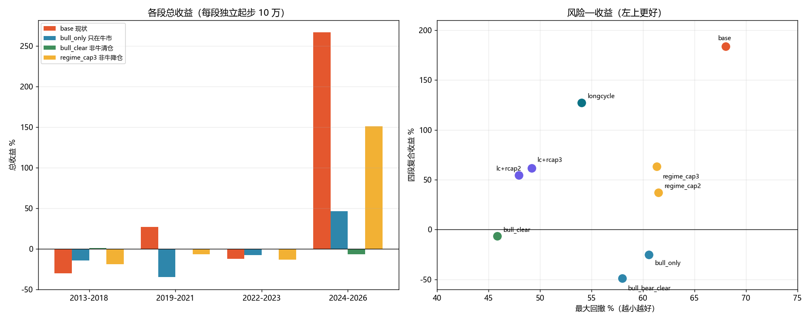

# 牛市 / 非牛市分支对照测试（第四轮）

日期：2026-10-30
对象：组合 `主板+创业板`（`pf_1791522403274487100_0002`，策略 `trend_pullback_low_buy`）
数据：`bin/portfolio.db` 副本 + 数据湖 `D:\workspace\stockTool\CNEquity\data\cnequity`

> 仍然没有改生产代码。全部通过测试里改写"调仓计划行"实现。
> 指数闸门固定 399006、广度保持绝对阈值。

---

## 一、测了什么

用户的问题：**如果按牛市 / 非牛市分两个应对分支，会怎么样？**

两种"牛市"定义都测了：

| 定义 | 来源 | 分支 |
|---|---|---|
| A. 内置市场状态 | `market_state` 表的 `bull/range/bear` | 只在牛市开仓 / 非牛市清仓 / 熊市清仓 / 非牛市降仓(20%、30%) |
| B. 指数长周期 | 399006 收盘 > MA250 | 指数在 MA250 上方才开仓（上一轮已验证） |

以及 A+B 叠加：指数在 MA250 上方才开仓，且非牛市单票压到 20%/30%。

**牛市 = `state=="bull"`；非牛市 = `range` 或 `bear`。** 四段独立回测：2013-2018 / 2019-2021 / 2022-2023 / 2024-2026。

---

## 二、结果

| 变体 | 2013-2018 | 2019-2021 | 2022-2023 | 2024-2026 | 全段复合 | 最大回撤 |
|---|---:|---:|---:|---:|---:|---:|
| **base（现状）** | −30.35% | +26.83% | −12.35% | **+266.54%** | **+183.8%** | 68.0% |
| bull_only（只在牛市开仓） | −14.61% | −35.03% | −7.54% | +46.08% | **−25.1%** | 60.6% |
| bull_clear（非牛市清仓） | +0.73% | −0.12% | −0.69% | −6.57% | **−6.6%** | **45.9%** |
| bull_bear_clear（熊市清仓） | −8.98% | −25.10% | −7.54% | −18.43% | **−48.6%** | 58.0% |
| regime_cap2（非牛市单票≤20%） | −18.72% | −15.25% | −14.32% | +132.36% | +37.1% | 61.5% |
| regime_cap3（非牛市单票≤30%） | −19.12% | −6.90% | −13.60% | +151.03% | +63.3% | 61.3% |
| lc+rcap2（指数>MA250 + 非牛≤20%） | +27.75% | −29.54% | +2.47% | +67.49% | +54.5% | 48.0% |
| lc+rcap3（指数>MA250 + 非牛≤30%） | +24.74% | −27.87% | +2.47% | +75.42% | +61.7% | 49.2% |
| *参考：longcycle（上一轮）* | *+11.45%* | *−15.91%* | *+2.47%* | *+136.46%* | *+127.1%* | *54.0%* |



---

## 三、结论

### 3.1 用内置 `market_state` 分牛/非牛，没有改善，反而更差

- **只在牛市开仓（bull_only）：−25.1%**，比 base 少 209 个百分点。
  原因是"牛市"状态来得晚、走得早：等它确认，涨幅已经走掉一半。
- **非牛市清仓（bull_clear）：−6.6%**，是全场最"稳"的一条曲线（四段都在 ±7% 内），
  但等于不赚钱——而且 **2024-2026 的超级牛市它也只做到 −6.6%**，
  因为状态在 bull/range 之间来回切，持仓被反复清掉。
- **熊市清仓（bull_bear_clear）：−48.6%**，最差。在熊市里清仓等于卖在低点，
  随后反弹又不敢买（状态还是 bear），两头挨打。
- **非牛市降仓（regime_cap2/3）：+37.1% / +63.3%**，保住了牛市的大部分收益
  （2024-2026 +132% / +151%），**但回撤仍然是 61%** ——
  因为"降仓"只作用于**新开仓**，已经建立的满仓仓位不会自动减小；
  2013-2018 的最大回撤来自牛市期间建立的仓位，跌下来时分支没有机会降仓。

**根因有两个：**
1. `market_state` 是滞后指标（由价格推导），不是"提前知道牛熊"。
   2015-06-12~08-26 的 53 个交易日里，仍有 **14 天标为 bull、13 天 range**；
   2018 年全年也有 37 天 bull。
2. 分支只能改"开仓/清仓"，改不了"已有仓位的大小"，所以对回撤的帮助有限。

### 3.2 用"指数 > MA250"定义牛/非牛，比内置状态好得多

同样问"牛/非牛分支"，把定义换成**指数自身在 MA250 上方**：

- longcycle：**+127.1%，回撤 54%**，2013-2018 和 2022-2023 两个熊市段都转正；
- 叠加"非牛市降仓"（lc+rcap3）反而变差：+61.7%，回撤 49%——降仓压掉了 2019-2021 的反弹。

说明：**不是"分牛/非牛"这个思路有用，而是"用哪个指标定义牛/非牛"决定成败。**
指数 MA250 是一个趋势确认器，比模型输出的三态标签更干净。

### 3.3 所有分支都没有创造更高的长期收益

| 方案 | 复合收益 | 最大回撤 | 收益/回撤 |
|---|---:|---:|---:|
| base | +183.8% | 68.0% | 2.70 |
| longcycle | +127.1% | 54.0% | 2.35 |
| lc+rcap3 | +61.7% | 49.2% | 1.26 |
| regime_cap3 | +63.3% | 61.3% | 1.03 |
| bull_clear | −6.6% | 45.9% | −0.15 |

base 的收益/回撤仍然最高，但它的收益几乎全部来自 2024-2026 一段；
任何"牛/非牛分支"都只是把收益和回撤在曲线上重新分配，没有产生新的 alpha。

---

## 四、建议

1. **不要用内置 `market_state` 做牛/非牛开关**：滞后、切换频繁，实测三个分支（只开仓/清仓/熊市清仓）全部跑输。
2. 如果一定要做"牛/非牛分支"，**用"指数 > MA250"定义**，而且只把它当**降回撤**工具：
   - 预期：长期收益约为 base 的 7 成，回撤从 68% 降到 54%；
   - 代价：2019-2021 这种"指数在 MA250 上方但个股难做"的年份会明显变差。
3. "非牛市降仓"（20%/30%）单独用能保住牛市收益，但**不解决回撤**（61%），不建议单独上。
4. 还是那句话：**想提高长期收益，下一步必须测选股**（当前 4600 选 1~5，胜率 23%）。

---

## 五、局限

1. 四段独立回测，段间持仓不连续；复合收益是连乘近似。
2. `market_state` 由项目自身的市场温度模型生成，本测试只消费它，没有校验其口径。
3. "非牛市清仓"会把持仓在状态切换日全部卖掉，实际交易成本可能高于回测（回测按开盘价撮合）。
4. 2026 年只到 10-28。

---

## 六、原始数据

- `reports/regime_exp/低吸指数闸门_实验指标.csv`
- `reports/regime_exp/低吸指数闸门_闸门统计.csv`
- `reports/regime_exp/低吸指数闸门_年度收益.csv`
- `reports/regime_exp/牛市分支_对比.png`

复现（regime_cap3 为例）：

```powershell
$env:FREESTOCK_GATE_EXP="1"
$env:FREESTOCK_GATE_DB="D:\workspace\go\stockSoft\freeStock\.gotmp\gate_exp\portfolio.db"
$env:FREESTOCK_GATE_LAKE="D:\workspace\stockTool\CNEquity\data\cnequity"
$env:FREESTOCK_GATE_PORTFOLIO="pf_1791522403274487100_0002"
$env:FREESTOCK_GATE_FROM="20130101"; $env:FREESTOCK_GATE_TO="20181231"
$env:FREESTOCK_GATE_VARIANTS="base,bull_only,bull_clear,bull_bear_clear,regime_cap2,regime_cap3"
$env:FREESTOCK_GATE_OUT="D:\workspace\go\stockSoft\freeStock\reports\regime_exp"
$env:GOGC="80"; $env:GOMEMLIMIT="10GiB"
go test ./internal/service -run "^TestLowBuyGateExperiment$" -v -count=1 -timeout 3h
```
