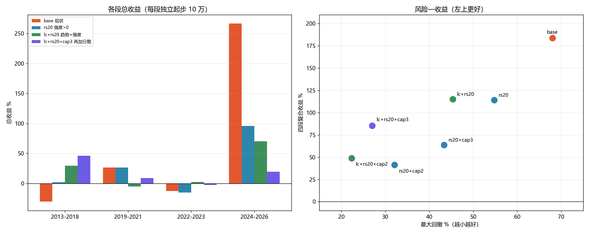

# 选股过滤与组合测试（第五轮）

日期：2026-10-30
对象：组合 `主板+创业板`（`pf_1791522403274487100_0002`，策略 `trend_pullback_low_buy`）
数据：`bin/portfolio.db` 副本 + 数据湖 `D:\workspace\stockTool\CNEquity\data\cnequity`

> 仍然没有改生产代码。选股过滤通过"丢弃计划里的买入行"实现：
> 条件不满足的候选当天不买，其余逻辑（评分、排序、撮合、费用）不变。

---

## 一、测了什么

**单因子筛选**（2013-2018，最差的一段）：

| 条件 | 含义 |
|---|---|
| rs20 | 20 日相对强度（相对沪深300）> 0 |
| ma60 | 收盘站上 MA60 |
| amt1e8 | 成交额 ≥ 1 亿 |
| dd12 | 20 日回撤落在 −3% ~ −12%（比默认 −18% ~ −1.5% 更严） |
| score60 | 总分 ≥ 60 |
| selA | >MA20 且 RS20>0 |
| selB | >MA20 且 >MA60 且 RS20>0 |
| selC | >MA20 且 RS20>0 且 回调 3~12% |
| selD | >MA20 且 RS20>0 且 同行业 ≤2 只 |

**组合测试**：把前几轮有增益的条件（`指数>MA250`、单票上限 20%/30%）与选股因子叠加，四段验证。

---

## 二、单因子筛选（2013-2018）

| 变体 | 总收益 | 最大回撤 | 成交 | 胜率 |
|---|---:|---:|---:|---:|
| base | −30.35% | 66.72% | 46 | 13.0% |
| **rs20** | **+2.00%** | 54.75% | 35 | 28.6% |
| ma60 | −19.19% | 62.53% | 47 | 14.9% |
| amt1e8 | −21.40% | 63.31% | 39 | 15.4% |
| dd12 | −10.95% | 56.03% | 38 | 15.8% |
| score60 | −34.83% | 64.10% | 43 | 18.6% |
| selA（>MA20+RS20） | −15.17% | 60.30% | 43 | 25.6% |
| selB（+>MA60） | −15.17% | 60.30% | 43 | 25.6% |
| selC（+回调带） | −14.08% | 58.72% | 37 | 27.0% |
| selD（+行业≤2） | −15.17% | 60.30% | 43 | 25.6% |

**只有 `RS20>0` 一个因子有效**：−30.4% → +2.0%，回撤 67%→55%。
- `>MA60`、`成交额`、`更严的回撤带`、`分数 ≥60` 都只是小幅改善或无效；
- **`>MA20` 与 `RS20` 叠加反而互相抵消**（selA 比 rs20 单独还差 17pp）：
  低吸买的是"回调"，再加"站上 MA20"会把真正便宜的买点筛掉；
- `MA60`/`行业≤2` 叠上去**完全没变化**（说明候选本来就满足，或持仓太少行业分散无从谈起）。

---

## 三、组合测试（四段）

| 变体 | 2013-2018 | 2019-2021 | 2022-2023 | 2024-2026 | 复合 | 最大回撤 | 复合/回撤 | 年化 |
|---|---:|---:|---:|---:|---:|---:|---:|---:|
| **base（现状）** | −30.35% | +26.83% | −12.35% | **+266.54%** | **+183.8%** | 68.0% | 2.70 | 8.5% |
| rs20 | +2.00% | +26.64% | −15.30% | +95.76% | +114.2% | 54.8% | 2.09 | 6.1% |
| rs20+cap3 | +13.57% | +30.95% | −16.62% | +32.09% | +63.8% | 43.4% | 1.47 | 3.9% |
| **lc+rs20** | +29.56% | −4.88% | +2.47% | +70.44% | **+115.2%** | 45.3% | 2.54 | 6.2% |
| lc+rs20+cap2 | +30.61% | +7.11% | −3.83% | +10.59% | +48.8% | **22.3%** | 2.19 | 3.2% |
| **lc+rs20+cap3** | **+46.04%** | **+9.13%** | −2.63% | +19.54% | **+85.5%** | **27.0%** | **3.16** | 4.9% |



### 结果怎么读

1. **`RS20>0` 是这一轮唯一真正的增量**：单独加上去，复合从 +184% 降到 +114%，
   但回撤从 68% 降到 55%，2013-2018 从 −30% 变 +2%。
2. **`longcycle`（指数>MA250）+ `rs20` 是"双确认"**：趋势 + 强度，
   复合 +115%、回撤 45%，收益几乎没比 rs20 少，回撤少 9pp。
3. **再叠加单票 30% 上限（lc+rs20+cap3）是风险收益最优的一档**：
   - 复合 +85.5%，最大回撤 **27%**，复合/回撤 **3.16**（base 2.70）；
   - 四段 +46.0% / +9.1% / −2.6% / +19.5%，**没有一段亏超过 3%**；
   - 但绝对收益只有 base 的 46%（年化 4.9% vs 8.5%）。
4. **cap2 比 cap3 更保守**：回撤压到 22%，但复合只有 +48.8%——过度分散把收益也摊薄了。

---

## 四、样本外检查（2010-09 ~ 2012-12）

| 变体 | 总收益 | 回撤 | 成交 |
|---|---:|---:|---:|
| base | +37.14% | 17.12% | 7 |
| rs20 | +38.27% | 16.44% | 6 |
| lc+rs20 | **0.00%** | 0.00% | 0 |
| lc+rs20+cap3 | **0.00%** | 0.00% | 0 |

2010-2012 创业板指一直在 MA250 下方，**长周期闸门让策略整段空仓**。
base 在这段靠 7 笔交易赚了 37%——样本太小，不能说明谁对，但它揭示了闸门的真实代价：
**它会在整段熊市里完全不交易，包括那些"熊市反弹"的机会。**
如果算上这三年，lc+rs20+cap3 的 2010-2026 年化会从 4.9% 降到约 3.9%。

---

## 五、结论与建议

**这五轮里，第一次出现"风险收益明显更好"的配置：**

> **指数 > MA250 才开仓 + 个股 RS20 > 0 才买 + 单票 ≤30%**
> 复合 +85.5%、最大回撤 27%、四段最差 −2.6%，复合/回撤 3.16（base 2.70）。

但它不是"免费午餐"：

- 绝对收益只有 base 的 46%（年化 4.9% vs 8.5%）；
- 会在整段熊市（如 2010-2012）完全空仓，错过反弹；
- 条件来自前几轮在同一批数据上的筛选，**存在样本内过拟合风险**。

**如果目标是"长期能拿住、回撤可控"，lc+rs20+cap3 是目前最好的答案。**
**如果目标是"绝对收益最大"，base 仍然最高，但要接受 68% 回撤和 2013-2023 的长期亏损。**

建议下一步（二选一）：
1. **滚动样本外验证**：把 2013-2026 切成 4 段，每次用 3 段选参数、1 段验证，看这套组合是否稳定；
2. **直接落地 lc+rs20+cap3**，先小仓位跑实盘对照。

---

## 六、局限

1. 四段独立回测（每段 10 万起步），段间持仓不连续；复合是连乘近似。
2. 选股过滤只作用于"开新仓"，不影响已有持仓；cap 也只夹新买入的预算。
3. `RS20` 用的是 `relative_strength_20d` 字段（相对沪深300 的 20 日超额），
   不是相对创业板指；换成别的基准结果可能不同。
4. 条件组合是在同一批数据上试出来的（2013-2018 筛选 + 四段确认），
   严格来说仍属样本内；2010-2012 只能算一次弱样本外（且长周期闸门整段空仓，信息量有限）。
5. 2026 年只到 10-28。

---

## 七、原始数据

- `reports/select_exp/低吸指数闸门_实验指标.csv`
- `reports/select_exp/低吸指数闸门_闸门统计.csv`
- `reports/select_exp/低吸指数闸门_年度收益.csv`
- `reports/select_exp/选股组合_对比.png`

复现（lc+rs20+cap3 为例）：

```powershell
$env:FREESTOCK_GATE_EXP="1"
$env:FREESTOCK_GATE_DB="D:\workspace\go\stockSoft\freeStock\.gotmp\gate_exp\portfolio.db"
$env:FREESTOCK_GATE_LAKE="D:\workspace\stockTool\CNEquity\data\cnequity"
$env:FREESTOCK_GATE_PORTFOLIO="pf_1791522403274487100_0002"
$env:FREESTOCK_GATE_FROM="20130101"; $env:FREESTOCK_GATE_TO="20181231"
$env:FREESTOCK_GATE_VARIANTS="base,rs20,lc+rs20,lc+rs20+cap2,lc+rs20+cap3"
$env:FREESTOCK_GATE_OUT="D:\workspace\go\stockSoft\freeStock\reports\select_exp"
$env:GOGC="80"; $env:GOMEMLIMIT="10GiB"
go test ./internal/service -run "^TestLowBuyGateExperiment$" -v -count=1 -timeout 3h
```
