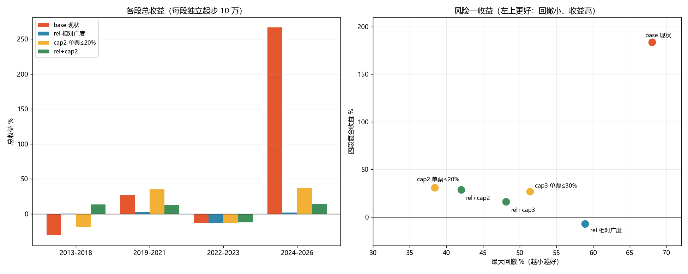

# 策略参数对照测试（第二轮）：相对广度阈值 & 单票权重上限

日期：2026-10-29
对象：组合 `主板+创业板`（`pf_1791522403274487100_0002`，策略 `trend_pullback_low_buy`）
数据：`bin/portfolio.db` 副本 + 数据湖 `D:\workspace\stockTool\CNEquity\data\cnequity`

> 仍然**没有改生产代码**。沿用第一轮的测试脚手架
> `internal/service/zz_gate_experiment_test.go`（默认跳过），
> 指数闸门固定为 399006.SZ（第一轮结论：保持创业板指），只改两个变量：
> **广度口径**（绝对只数 / 相对比例）和**单票层数上限**（即单票权重）。

---

## 一、两个变量的定义

| 变量 | 现状 | 实验组 |
|---|---|---|
| 广度口径 | `ready >= 1000/1500/2000/2600`（绝对只数） | 把 ready 按当日全市场股票数折成 5000 只口径：`ready × 5000 / universe`，等价于阈值变成 20%/30%/40%/52% |
| 单票权重 | 目标只数=1 时 `LowBuyEntryLayerCount(10,1)=10` 层 → **单票 100%** | 计划行层数夹到 2 层 = **单票 ≤20%**；或 3 层 = ≤30% |

### ⚠ 实测踩到的坑：`MaxLayersPerStock` 不限制买入预算

第一版只把 `cfg.MaxLayersPerStock` 设成 2，结果 cap2 与 base **完全同一条净值曲线**。
原因在 `internal/backtest/run.go:210`：

```go
budget := e.layerBudget(executionNAV, layerDelta)   // layerDelta 来自计划行
```

`buyPosition` 里虽然把 `target` 夹到了 `MaxLayersPerStock`，但**花的钱是按计划行的
`LayersDelta` 算的**——层数记账被夹住、预算没被夹住。所以生产代码里
`MaxLayersPerStock` 对低吸的"单票 100%"其实没有任何约束力。

本轮的 cap 实验因此改成**同时夹计划行**的 `TargetLayers/LayersDelta`
（见 `capPlanLayers`），预算才会真的降到 20%/30%。

---

## 二、结果（四段独立回测，每段 10 万起步）

### 2.1 各段总收益

| 变体 | 2013-2018 | 2019-2021 | 2022-2023 | 2024-2026 | **2013-2023 小计** | **全段复合** | 最大回撤 |
|---|---:|---:|---:|---:|---:|---:|---:|
| base（现状：绝对广度 + 单票满仓） | -30.35% | +26.83% | -12.35% | **+266.54%** | **-22.6%** | **+183.8%** | 68.0% |
| rel（相对广度） | +0.76% | +3.18% | -12.35% | +2.06% | -8.9% | **-7.0%** | 58.9% |
| cap2（单票 ≤20%） | -19.12% | +35.32% | -12.44% | +36.57% | -4.2% | +30.9% | **38.4%** |
| cap3（单票 ≤30%） | -29.02% | +36.20% | -15.48% | +55.24% | -18.3% | +26.8% | 51.4% |
| rel+cap2 | **+13.63%** | +12.59% | -12.07% | +14.40% | **+12.5%** | +28.7% | 42.0% |
| rel+cap3 | -0.18% | +13.34% | -14.99% | +20.81% | -3.8% | +16.2% | 48.1% |

> "全段复合" = 四段收益连乘；"最大回撤" = 四段里最大的那一段的回撤。

### 2.2 风险收益对照

| 变体 | 全段复合 | 最大回撤 | 复合/回撤 | 最差单段 | 收益最稳定？ |
|---|---:|---:|---:|---:|---|
| base | +183.8% | 68.0% | 2.70 | -30.4% | 否（-30% ~ +267%） |
| rel | -7.0% | 58.9% | -0.12 | -12.4% | 否 |
| cap2 | +30.9% | 38.4% | 0.80 | -19.1% | 一般 |
| cap3 | +26.8% | 51.4% | 0.52 | -29.0% | 否 |
| rel+cap2 | +28.7% | 42.0% | 0.68 | **-12.1%** | **是（四段都在 ±15%）** |
| rel+cap3 | +16.2% | 48.1% | 0.34 | -15.0% | 一般 |



---

## 三、结论

### 3.1 相对广度阈值：**是倒退，不是改进**

- `rel` 把全段复合从 **+183.8% 打到 -7.0%**。
- 机制：相对阈值把目标只数从"1~2 只"抬到"最多 5 只"，**稀释了收益来源**。
  2013-2018 它确实把 -30.4% 修到 +0.8%（这段是震荡市，分散有用），
  但 2024-2026 从 +266.5% 掉到 +2.1%——2026 年那几只翻倍票（国科微 +79.9%、华工科技 +44%）
  原来是一只满仓，现在只占 1/5。
- **我上一轮的猜测（绝对阈值在早期市场里失真）被数据否掉了**：阈值确实"失真"，
  但失真的方向恰好让策略在大部分年份保持低仓位、只在少数机会重仓——这正是它的收益来源。
- 结论：**不要改成相对比例**。

### 3.2 单票上限：唯一有效的风控，但代价很大

- `cap2` 把最大回撤从 **68.0% 压到 38.4%**，而且 **3/4 段收益不低于 base**
  （2013-2018：-19.1% vs -30.4%；2019-2021：+35.3% vs +26.8%；2022-2023 基本持平），
  只在 2024-2026 单边牛里大幅落后（+36.6% vs +266.5%）。
- `cap3`（30%）反而更差（复合 +26.8%、回撤 51.4%）：
  30% 的仓位既不够分散（仍是一只票主导），又不够集中（牛市跟不满）。
  这说明"20% = 5 只满配"才是有意义的分散档位。
- 代价：全段复合从 +183.8% 降到 +30.9%（12.8 年，约 2.1%/年）。

### 3.3 最刺眼的事实：这个策略 2013-2023 是亏的

- `base` 在 2013-2023 累计 **-22.6%**，全靠 2024-2026 的 +266.5% 翻身。
- `cap2` 2013-2023 也是 -4.2%，只是 2024-2026 少赚。
- 唯一在 2013-2023 赚钱的是 `rel+cap2`（+12.5%），但它 12 年复合也只有 +28.7%（约 2.1%/年）。

也就是说：**"收益不好"的主因不是指数闸门、也不是广度阈值，而是策略本身的收益结构——
长期不赚钱，靠极少数重仓大牛股翻身。** 任何"降波动"的改动都会同时砍掉翻身的那一段。

### 3.4 建议

| 目标 | 选择 | 理由 |
|---|---|---|
| 保留高收益、能接受大回撤 | **base 不动** | 全段 +183.8%，但 68% 回撤、2013-2023 亏 22.6% |
| 压回撤、能接受少赚 | **cap2（单票 20%）** | 回撤 38%，3/4 段不输 base，牛市少赚 |
| 要"每年都别太难看" | **rel+cap2** | 四段全在 ±15%，但 12 年只有 2.1%/年 |
| 想靠调广度阈值提高收益 | **不要做** | rel 全段 -7.0%，明确证伪 |

如果一定要改代码，优先级：
1. **cap2**（要同时改 `run.go` 的 budget 计算，否则 `MaxLayersPerStock` 不生效）；
2. **不要**动广度阈值；
3. 下一轮该测的是**出场规则**（120 笔 MA30×0.96 止损里 103 笔是亏的）
   和**选股质量**，而不是继续调仓位。

---

## 四、局限

1. 四段独立回测，段间持仓不连续；复合收益是近似，不能等同于一次 2013-2026 连续回测。
2. 2026 年只到 10-28。
3. cap 实验通过"夹计划行层数"实现，等价于"每笔买入预算 ≤ 20% 总资产"；
   受段内资金增长影响，实际单票市值占比会在 20% 上下浮动（没有再平衡）。
4. 相对广度按 5000 只口径折算，参考值只影响阈值对应的百分比（1000→20%），
   换一个参考值结果会略有不同，但方向不会变。

---

## 五、原始数据

- `reports/strategy_exp/低吸指数闸门_实验指标.csv`（24 行 = 6 变体 × 4 段）
- `reports/strategy_exp/低吸指数闸门_闸门统计.csv`
- `reports/strategy_exp/低吸指数闸门_年度收益.csv`
- `reports/strategy_exp/策略参数_对比.png`

复现（以 cap2 为例）：

```powershell
$env:FREESTOCK_GATE_EXP="1"
$env:FREESTOCK_GATE_DB="D:\workspace\go\stockSoft\freeStock\.gotmp\gate_exp\portfolio.db"
$env:FREESTOCK_GATE_LAKE="D:\workspace\stockTool\CNEquity\data\cnequity"
$env:FREESTOCK_GATE_PORTFOLIO="pf_1791522403274487100_0002"
$env:FREESTOCK_GATE_FROM="20130101"; $env:FREESTOCK_GATE_TO="20181231"
$env:FREESTOCK_GATE_VARIANTS="base,rel,cap2,rel+cap2,rel+cap3"
$env:FREESTOCK_GATE_OUT="D:\workspace\go\stockSoft\freeStock\reports\strategy_exp"
$env:GOGC="80"; $env:GOMEMLIMIT="10GiB"
go test ./internal/service -run "^TestLowBuyGateExperiment$" -v -count=1 -timeout 3h
```
