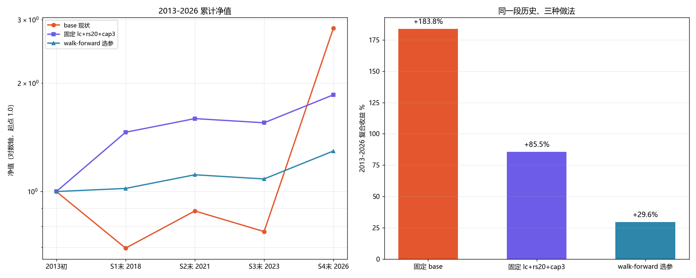

# 滚动样本外验证（第六轮）

日期：2026-10-30
对象：组合 `主板+创业板`（`pf_1791522403274487100_0002`，策略 `trend_pullback_low_buy`）
数据：`bin/portfolio.db` 副本 + 数据湖 `D:\workspace\stockTool\CNEquity\data\cnequity`

> 目的：验证第五轮的"趋势+强度+分散"组合（lc+rs20+cap3）**是不是过拟合**。
> 方法：把 2010-2026 切成 5 段，用**扩展窗口**做滚动选择——
> 每一折只用"过去所有段"挑参数，再到"下一段"上验证。

---

## 一、分段与候选

| 段 | 区间 | 长度 |
|---|---|---|
| S0 | 2010-09-01 ~ 2012-12-31 | 2.3 年 |
| S1 | 2013-01-01 ~ 2018-12-31 | 6.0 年 |
| S2 | 2019-01-01 ~ 2021-12-31 | 3.0 年 |
| S3 | 2022-01-01 ~ 2023-12-31 | 2.0 年 |
| S4 | 2024-01-01 ~ 2026-10-28 | 2.8 年 |

候选 7 个：`base`、`rs20`、`rs20+cap2`、`rs20+cap3`、`lc+rs20`、`lc+rs20+cap2`、`lc+rs20+cap3`。
选择准则：训练段上的 **复合收益 / 最大回撤**（风险收益比）。

## 二、分段收益（%）

| 变体 | S0 2010-2012 | S1 2013-2018 | S2 2019-2021 | S3 2022-2023 | S4 2024-2026 |
|---|---:|---:|---:|---:|---:|
| base | +37.14 | −30.35 | +26.83 | −12.35 | **+266.54** |
| rs20 | +38.27 | +2.00 | +26.64 | −15.30 | +95.76 |
| rs20+cap2 | +8.68 | +11.01 | +22.55 | −13.15 | +19.62 |
| rs20+cap3 | +12.72 | +13.57 | +30.95 | −16.62 | +32.09 |
| lc+rs20 | **0.00** | +29.56 | −4.88 | +2.47 | +70.44 |
| lc+rs20+cap2 | **0.00** | +30.61 | +7.11 | −3.83 | +10.59 |
| lc+rs20+cap3 | **0.00** | +46.04 | +9.13 | −2.63 | +19.54 |

---

## 三、扩展窗口 walk-forward

每一折用**过去所有段**选参数，到下一段验证：

| 折 | 训练段 | 选中 | 训练分数 | 验证段 | 验证收益 | 该段排名 |
|---|---|---|---|---:|---|---:|---:|
| 1 | S0 | rs20 | 2.33 | S1 2013-2018 | **+2.00%** | 6/7 |
| 2 | S0+S1 | lc+rs20+cap3 | 1.70 | S2 2019-2021 | +9.13% | 5/7 |
| 3 | S0+S1+S2 | lc+rs20+cap3 | 2.20 | S3 2022-2023 | −2.63% | 2/7 |
| 4 | S0+S1+S2+S3 | lc+rs20+cap3 | 2.04 | S4 2024-2026 | +19.54% | 6/7 |

**四折连乘：+29.6%**（2013-2026，约 13.8 年 → 1.9%/年）

对比：

| 策略 | S1-S4 复合 | 最大回撤 |
|---|---:|---:|
| 固定 base | **+183.8%** | 68.0% |
| 固定 lc+rs20+cap3 | +85.5% | 27.0% |
| **walk-forward 选择** | **+29.6%** | 27.0% |

---

## 四、用 2010-2018 选、2019-2026 验证

| 变体 | 训练分（S0+S1） | 样本外 S2-S4 | 样本外回撤 |
|---|---:|---:|---:|
| **lc+rs20+cap3（训练选中的）** | **1.70** | **+27.0%** | **25.5%** |
| lc+rs20+cap2 | 1.53 | +13.9% | 22.3% |
| rs20 | 0.75 | +110.0% | 47.9% |
| lc+rs20 | 0.70 | +66.1% | 45.3% |
| rs20+cap3 | 0.65 | +44.2% | 25.4% |
| rs20+cap2 | 0.64 | +27.3% | 21.6% |
| base | −0.07 | **+307.5%** | 68.0% |

---

## 五、结论

**1. "按近期表现选参数"这套流程本身不赚钱。**
四折 walk-forward 只做出 +29.6%，低于任何一条固定规则（base +183.8%、固定组合 +85.5%）。
第一折就用 S0 的短期表现选中了 `rs20`，而它在 S1 只排 6/7——**训练期表现和验证期表现几乎不相关**。

**2. 第五轮的组合没有被验证成"更高的收益"，只被验证成"更低的回撤"。**
- 2019-2026 样本外：+27.0%，回撤 25.5%；
- 同期 base：+307.5%，回撤 68%。
- 它确实躲过了 2013-2018 和 2022-2023 的亏损，代价是几乎放弃了 2024-2026 的爆发。

**3. base 的高收益不可复制。**
base 的 +184% 里，2024-2026 一段贡献 +266%；在同一套规则下，任何"降波动"的改动都会把这段削掉。
换句话说：**这个策略的历史收益不是"能力"，是"2024-2026 的集中押注"**。

**4. 选择准则是稳定的，但结果一般。**
从第 2 折开始，训练集每次都选中 `lc+rs20+cap3`——说明这条规则在"风险收益比"上确实是最优的；
但它在每一段都排 2~6 名，不是收益冠军。

---

## 六、建议

- **不要部署"滚动选参"机制**：实测它跑输固定规则，纯粹是噪声驱动。
- **如果目标是回撤可控**：`lc+rs20+cap3` 站得住——样本外 +27%、回撤 25.5%、最差一段 −2.6%。
- **如果目标是收益**：本轮没有找到能提高长期收益的规则；base 的高收益不可复制，不应作为预期。
- 真要提高收益，只剩**改候选模型本身**（评分权重/因子），而不是在策略外面加过滤。

---

## 七、局限

1. 5 段独立回测，段间持仓不连续；组合收益按段连乘。
2. walk-forward 只有 4 折，样本很少；结论方向可信，具体数字不必当真。
3. 候选集合是前几轮在同一批历史上试出来的，滚动验证只能检验"选择流程"，不能完全消除候选集合的样本内偏差。
4. 2026 年只到 10-28。

---

## 八、原始数据

- S0（2010-2012，7 个候选）：`reports/walkforward/低吸指数闸门_实验指标.csv`
- S1-S4（7 个候选 + 单因子筛选）：`reports/select_exp/低吸指数闸门_实验指标.csv`
- 年度收益 / 闸门统计：上述两个目录下的同名文件
- 对比图：`reports/walkforward/滚动样本外对比.png`
